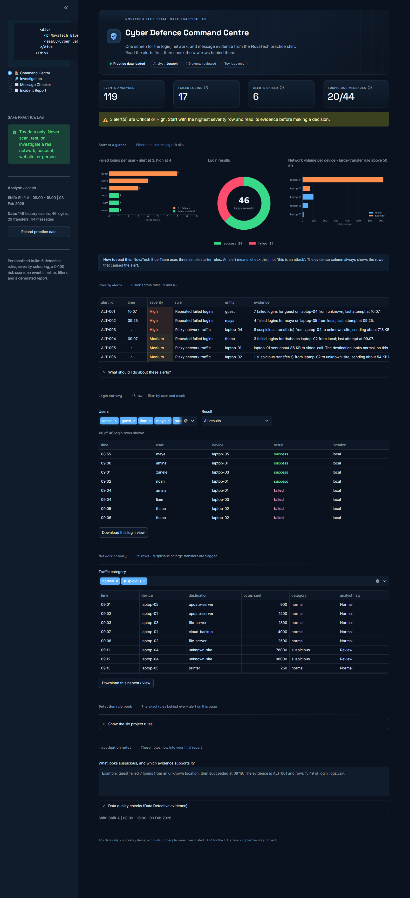

# NovaTech Blue Team - Cyber Defence Command Centre

A safe, defensive cyber-security dashboard for **fictional** factory logs. Built for the
FIT Phase 2 Cyber Security project, then personalised with a full detection engine, a risk
score, a timeline, filters, and a generated incident report.

> **Safe lab only.** Every row is toy data. Nothing in this project scans, tests, or
> investigates a real network, account, website, or person.



## What it does

| Page | What the analyst gets |
|---|---|
| **Command Centre** | KPIs, failed-login and network charts, priority alerts, filterable logs, an editable investigation notebook, and data-quality checks. |
| **Investigation** | The combined 149-event factory log on a colour-coded timeline, a 0-100 risk score, severity filters, the alert evidence, and recommended actions. |
| **Message Checker** | A Naive Bayes phishing classifier with confidence, recognised signal words, and a scored table of every practice message. |
| **Incident Report** | Final checklist, analyst notes, auto-generated findings, and one-click download of the finished Markdown report. |

### Detection rules

| ID | Rule | Fires when | Severity |
|---|---|---|---|
| R1 | Repeated failed logins | 3+ failures for one user | High at 4+ |
| R2 | Risky network traffic | Suspicious destination or >50 KB sent | High for repeat offenders |
| R3 | Login burst | 3+ failures in 10 minutes for one user + IP | High at 4+ |
| R4 | Critical event | A log row is marked `CRITICAL` | Critical |
| R5 | Risky removable media | USB on a server, or a file opened from a drive | High |
| R6 | Unusual password reset | A `HIGH` reset request | High |

The risk score adds weighted alerts (**Critical 20, High 8, Medium 3, Low 1**, capped at 100).
It is a teaching score, not a scientific measurement, and the report says so.

## Quick start

```powershell
cd cyber_Defense_command_center
python -m pip install -r requirements.txt
streamlit run app/dashboard.py
```

The app resolves `data/` from its own location, so the terminal's working directory does not
matter. Press `Ctrl + C` in the terminal to stop it.

## Project structure

```text
cyber_Defense_command_center/
├─ app/
│  ├─ dashboard.py          # page router, sidebar, caching
│  ├─ config.py             # names, thresholds, colours  <- personalise here
│  ├─ data_loader.py        # reads and cleans the four CSVs
│  ├─ detections.py         # rules R1-R6, risk score, recommendations
│  ├─ classifier.py         # toy Naive Bayes model
│  ├─ report_builder.py     # builds Incident_Report.md
│  ├─ charts.py             # matplotlib charts
│  ├─ theme.py              # CSS and shared UI pieces
│  ├─ views/                # the four dashboard pages
│  ├─ test_data.py          # data sanity check
│  ├─ detect_logins.py      # command-line alerts
│  └─ message_model.py      # command-line classifier demo
├─ data/
│  ├─ login_logs.csv
│  ├─ network_logs.csv
│  ├─ messages.csv
│  └─ factory_security_logs.csv
├─ reports/Incident_Report.md
├─ screenshots/
├─ tests/run_checks.py
├─ .streamlit/config.toml
└─ requirements.txt
```

## Personalise it

Open `app/config.py` and change:

- `TEAM_NAME`, `PROJECT_NAME`, `ANALYST_NAME`, `FACILITY`
- `FAILED_LOGIN_THRESHOLD`, `HIGH_FAILED_LOGIN_THRESHOLD`, `LARGE_TRANSFER_BYTES`
- `SEVERITY_WEIGHTS` to make the risk score stricter or softer

Then add more rows to any CSV. The dashboard picks them up automatically; press
**Reload practice data** in the sidebar if a page still shows the old rows.

## Command-line helpers

```powershell
python app/test_data.py          # confirm all four CSV files load
python app/detect_logins.py      # print R1 and R2 alerts
python app/message_model.py      # classify sample messages
python app/report_builder.py     # refresh reports/Incident_Report.md
python tests/run_checks.py       # full automated test plan
```

## Test plan

`python tests/run_checks.py` verifies file loading, row counts, duplicate and timestamp
handling, every rule, the risk score, both classifier labels, the "I do not know" path, and
the report sections. It exits with code 1 if a check fails.

## Evidence for the badges

- **Cyber Safety** - the sidebar safety card and the closing statement in every report.
- **Data Detective** - `data_loader.py` documents every column; the Command Centre shows a
  data-quality table.
- **Alert Builder** - six rules in `detections.py`, each with a written reason and action.
- **Dashboard Engineer** - four pages, KPIs, charts, filters, timeline, downloads.
- **Incident Analyst** - `reports/Incident_Report.md` with evidence, risk, and actions.
- **Showcase Ready** - the Incident Report page doubles as a demo script.

All data is fictional. This project is for learning defence only.
